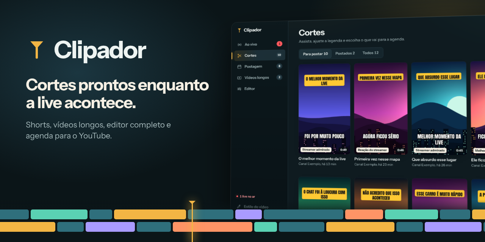
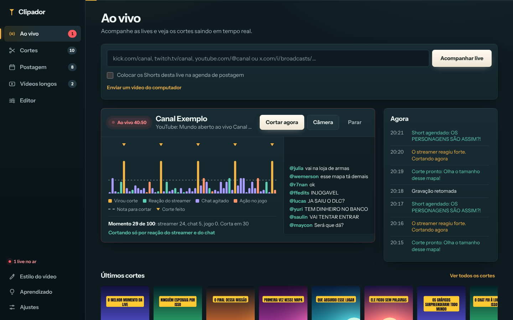
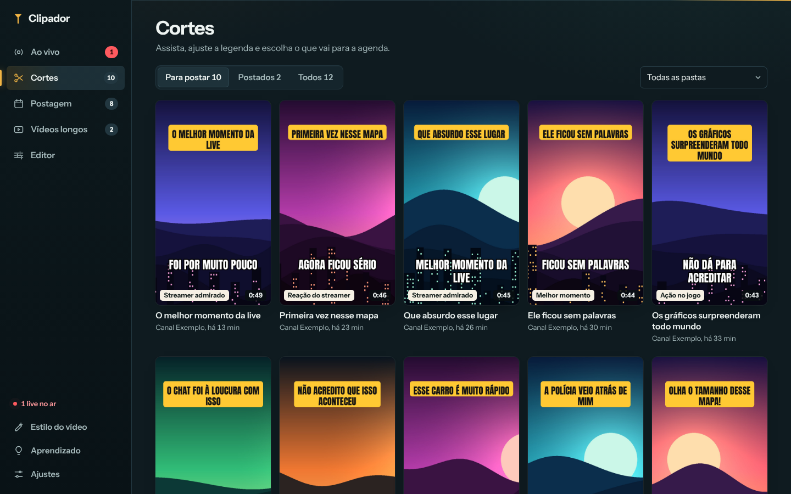
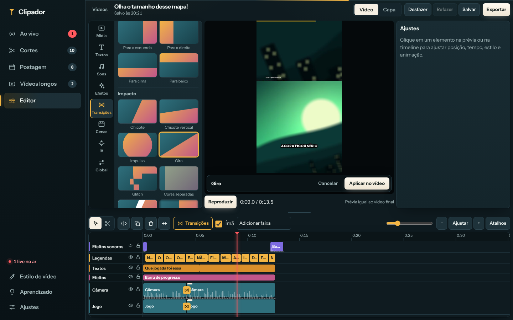
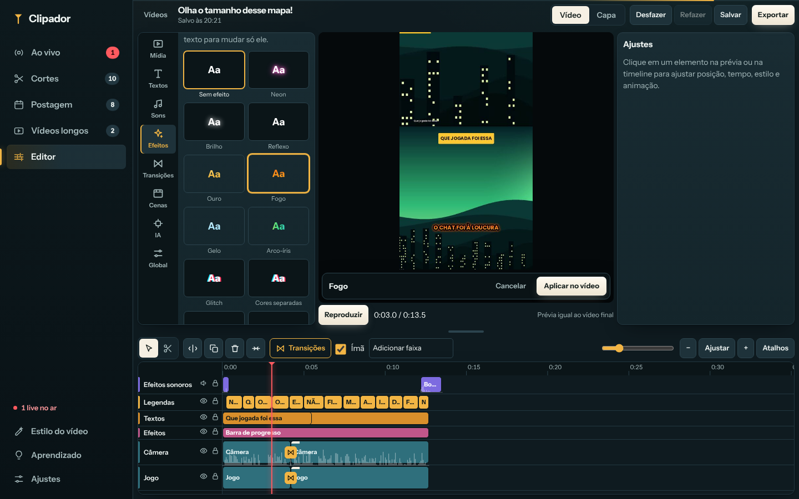
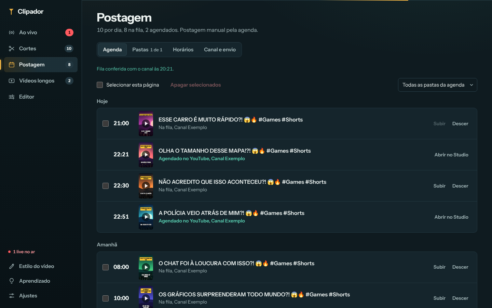
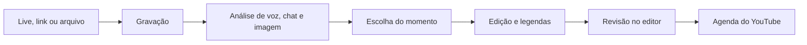

<p align="center">
  
</p>

<p align="center">
  <a href="../../releases/latest"></a>
  
  
  <a href="LICENSE"></a>
</p>

<p align="center">
  <a href="../../releases/latest"><b>Baixar o instalador</b></a> &nbsp;&nbsp;|&nbsp;&nbsp;
  <a href="#o-que-ele-faz"><b>Recursos</b></a> &nbsp;&nbsp;|&nbsp;&nbsp;
  <a href="#rodar-pelo-código"><b>Rodar pelo código</b></a> &nbsp;&nbsp;|&nbsp;&nbsp;
  <a href="CONTRIBUTING.md"><b>Contribuir</b></a>
</p>

O **Clipador** acompanha lives do Kick, Twitch, YouTube e X, encontra os melhores momentos e entrega Shorts e vídeos longos editados enquanto a transmissão ainda está no ar. Também corta lives que já acabaram e vídeos enviados do seu computador. Tudo roda na sua máquina.



## O que ele faz

| | |
|---|---|
| **Corta durante a live** | Grava sem parar e avalia a voz do streamer, o chat e a ação na tela para decidir o que vira corte. |
| **Respeita o assunto** | Acha onde o assunto começa e termina: cada corte traz a preparação, o momento e o desfecho, sem frase pela metade nem pedaço de outro assunto. |
| **Segue quem fala** | Com duas ou mais pessoas na tela, o vertical mostra quem está com a palavra. |
| **Posts de frase** | As frases mais fortes viram posts com o rosto de quem falou, para o feed e os stories. |
| **Aceita link ou arquivo** | Cole o link de uma live encerrada ou envie um vídeo do computador. |
| **Edita sozinho** | Enquadra a webcam, cria legendas com Whisper, título, zooms, efeitos sonoros e transições. |
| **Editor completo** | Timeline com várias faixas, atalhos, keyframes, capas e exportação em 1080p ou 4K. |
| **Prévia antes de aplicar** | Veja transições, efeitos e modelos de legenda no seu vídeo antes de colocar. |
| **Posta no YouTube** | Agenda Shorts por pastas e horários. Vídeos longos só saem depois da sua revisão. |
| **Aprende com você** | Usa suas edições e vídeos de referência para melhorar os próximos cortes. |
| **Efeitos de estúdio** | 28 transições, 28 efeitos de vídeo, packs de texto com relevo 3D e degradês, LUTs .cube e 24 efeitos de voz. |
| **Ferramentas de edição** | Corta pausas e vícios, traduz legendas, segue o rosto, divide a tela para duas pessoas, congela quadro e marca as batidas da música. |
| **Leva para outros editores** | Exporta a timeline em XML para o Premiere Pro e o DaVinci Resolve, com as legendas em .srt. |

<table>
  <tr>
    <td width="50%"><p align="center"><b>Biblioteca de cortes</b></p></td>
    <td width="50%"><p align="center"><b>Editor e transições</b></p></td>
  </tr>
  <tr>
    <td width="50%"><p align="center"><b>Efeitos em textos e legendas</b></p></td>
    <td width="50%"><p align="center"><b>Agenda de postagem</b></p></td>
  </tr>
</table>

## Como funciona



## Instalar no Windows

1. Abra a página de [versões](../../releases/latest) e baixe `Clipador-Instalador.exe`.
2. Abra o arquivo e clique em **Avançar**.
3. Use o atalho **Clipador** na área de trabalho.

Para atualizar, feche o programa e instale a versão nova por cima.

## Rodar pelo código

Você precisa do [Python 3.12](https://www.python.org/downloads/) e do [FFmpeg](https://ffmpeg.org/download.html).

```bash
git clone <endereço-deste-repositório>
cd clipador
```

| Sistema | Comando |
|---|---|
| Windows | `iniciar.bat` |
| Linux e macOS | `bash iniciar.sh` |

O painel abre em `http://127.0.0.1:8420`. Para gerar o instalador no Windows, rode `criar-exe.bat`.

## Atalhos novos do editor

| Ação | Atalho |
|---|---|
| Congelar quadro na agulha | `Shift + F` |
| Marcador (as batidas da música também viram marcadores) | `M` |
| Ligar e desligar o ímã, que agora gruda nos marcadores | `N` |

## Plataformas

| Plataforma | Link aceito |
|---|---|
| Kick | `kick.com/canal` |
| Twitch | `twitch.tv/canal` |
| YouTube | `youtube.com/@canal` ou `youtube.com/watch?v=...` |
| X | `x.com/i/broadcasts/...` |

Para postar no YouTube, siga o guia [CONFIGURAR-YOUTUBE.md](CONFIGURAR-YOUTUBE.md).

## Privacidade

Vídeos, contas e chaves ficam no seu computador. O painel só aceita conexões da própria máquina. Corte e publique apenas conteúdo que você tem permissão para usar.

## Licença

Distribuído sob a licença [GPL-3.0](LICENSE). Os componentes de terceiros estão listados em [AVISOS-DE-TERCEIROS.md](AVISOS-DE-TERCEIROS.md).
